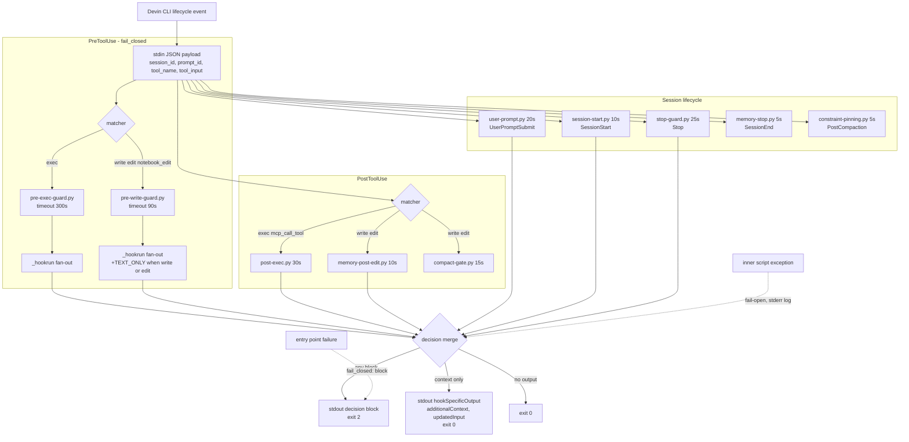

# Hook event flow

Stdin JSON payload to merged stdout decision, per lifecycle event. Entry
points are the 10 commands wired in `hooks.v1.json`; inner scripts run
in-process through `scripts/_hookrun.py`. Merge rules: first `block`
wins (exit 2), `additionalContext` concatenates, `updatedInput`
shallow-merges, an inner-script crash is fail-open. `fail_closed` on the
entry covers failure of the entry point itself (PreToolUse only).

Inner-script lists per entry point live in `.devin/docs/TOOLS-MAP.md`
(hook table) and `.devin/docs/HOOKS-PIPELINE.md` (merge contract).
