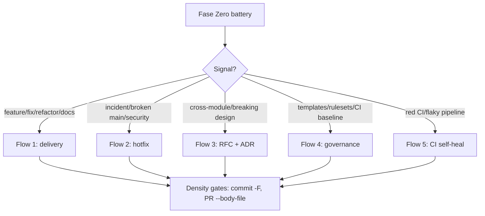

# Decision flows: the five delivery patterns

The adaptive decision engine routes every git/GitHub task to exactly one
of these flows. Each flow assumes Fase Zero already ran (see
`../SKILL.md`). Commands live in `gh-arsenal.md`; body formats live in
`density-templates.md`.

## Flow 1: feature / fix / refactor delivery (default)

For any scoped change tied to an issue.

1. **Traceability first.** Find or create the issue
   (`gh issue create --body-file`); branch name follows
   `<type>/<issue>-<slug>` (e.g. `fix/612-adaptive-git-github`).
2. **Isolate.** Worktree via `using-git-worktrees` when the change is
   large or the tree is dirty.
3. **Implement** in atomic commits; each commit body via
   `git commit -F <file>` with `Refs: #N`.
4. **Verify locally** before pushing: tests, lint, typecheck - whatever
   CI will run.
5. **PR.** `gh pr create --body-file <file>` with Summary, Evidence,
   Merge Danger, validation checklist, `Closes #N`.
6. **CI green.** Watch `gh run watch` / `gh run view <id>`; fix
   deterministically (flow 5 if the failure is in the pipeline itself).
7. **Merge** per repo strategy (`gh pr merge --squash --auto` when
   auto-merge is enabled); delete branch if
   `deleteBranchOnMerge` is off and cleanup is wanted.
8. **Close the loop.** Confirm the issue closed, comment evidence if
   useful, run `finishing-a-development-branch` cleanup.

## Flow 2: critical hotfix (fast-track)

Production is down or `main` is broken. Speed matters, but traceability
does not get skipped - it gets compressed.

1. **Fase Zero, minimal.** `git status -sb`, `git log -n 5`,
   `gh run list` to confirm blast radius. Skip capability probes you do
   not need.
2. **Issue still exists.** `gh issue create --label hotfix` (or reuse
   the incident issue). One line of context beats zero lines later.
3. **Branch from the release point.** `hotfix/<issue>-<slug>` off the
   tag/commit that is actually deployed, not off `main` HEAD if they
   diverged.
4. **Smallest possible diff.** No drive-by refactors; the regression
   test proving the fix lands in the same PR when feasible.
5. **Regression test is mandatory** for code fixes: a test that fails
   on the broken code and passes on the fix. If truly impossible
   (config-only), say so explicitly in the PR body.
6. **PR with fast-track body.** `--body-file`, `Closes #N`, explicit
   "hotfix" callout, rollback note.
7. **Merge + patch release.** Merge to the release branch first, then
   back-merge to `main` (or open the backport PR immediately). Cut a
   patch release: annotated tag `vX.Y.(Z+1)` on the release commit,
   `gh release create vX.Y.Z --generate-notes`, verify with
   `gh run view` that release CI is green.
8. **Postmortem hook.** File or update an issue with root cause and the
   regression test reference; `Refs:` the hotfix PR.

Patch release checklist: tag is annotated (`git tag -a`), release notes
generated, `gh attestation verify` if the repo signs builds, deployed
version confirmed via health endpoint or `deploy` skill smoke test.

## Flow 3: architectural change (RFC + ADR)

Cross-module design, new subsystem, breaking API, or anything that will
be expensive to reverse.

1. **RFC first.** Write the proposal as an issue (`gh issue create
   --label rfcs` or the repo's RFC convention) or a doc under
   `docs/`; solicit review before code.
2. **ADR recorded.** Once decided, write `.devin/adr/NNN-<slug>.md`
   following the repo's ADR format (see `.devin/adr/` for examples);
   the ADR captures context, decision, alternatives, consequences.
3. **Phased delivery.** Split into sub-issues (`gh issue create
   --parent <RFC#>` or `gh issue edit <RFC#> --add-sub-issue ...`) so
   each phase is independently mergeable.
4. **Each phase is flow 1.** Same density gates; ADR referenced via
   `Refs:` in commits and PRs.
5. **Migration notes.** Breaking changes ship with upgrade instructions
   in the PR body and, when user-facing, in release notes.

## Flow 4: repo governance / bootstrap

Setting up or repairing the repo's Git/GitHub surface: templates,
labels, rulesets, environments, secrets/variables, dependabot, CI
baseline.

1. **Fase Zero deep.** `gh repo view --json ...` for capabilities,
   `gh api repos/{o}/{r}/rulesets`, `.github/` tree listing, existing
   templates.
2. **One governance PR per concern** when possible (templates vs
   rulesets vs workflows) so review stays focused.
3. **Rulesets via API.** `gh api repos/{o}/{r}/rulesets` to inspect;
   create/update via `gh api repos/{o}/{r}/rulesets -X POST --input
   ruleset.json`. Require status checks, PR reviews, linear history per
   repo policy.
4. **Secrets/variables.** `gh secret set NAME` / `gh variable set
   NAME` for CI config; environment-scoped variants via `--env`.
   Never commit values.
5. **Environments.** `gh api repos/{o}/{r}/environments` for deploy
   gates; protection rules and required reviewers via the same API.
6. **Verify.** Re-run `phase-zero.py` and diff the governance picture;
   open a trivial test PR to prove rulesets fire.

## Flow 5: CI self-healing

Red pipeline, flaky test, or workflow misconfiguration.

1. **Diagnose before touching.** `gh run list --limit 10`,
   `gh run view <id> --log-failed`, `gh workflow view <name>`. The
   `debug-ci-failures` skill owns the deep playbook.
2. **Classify the failure:**
   - Flake (timing, network, ordering): quarantine or fix the flake;
     do not retry-loop it green.
   - Deterministic code failure: normal flow 1 fix.
   - Pipeline/config failure (permissions, pinning, cache, secrets):
     fix the workflow; review with `github-actions` skill rules.
3. **Minimal diff.** CI fixes are code changes: same commit/PR density
   gates, `Closes #N` against the tracking issue.
4. **Verify green twice.** Re-run the failed job
   (`gh run rerun <id> --failed`) and confirm a subsequent push or
   rerun stays green; flakes that recur get a tracking issue.
5. **Prevent recurrence.** Timeout, `concurrency:`, cache keys,
   pinned actions - apply the `github-actions` checklist so the same
   failure class cannot return silently.

## Cross-flow rules

- Every flow ends with density gates: `git commit -F`,
  `gh pr create --body-file`, `Refs:`/`Closes #` wiring.
- Every flow starts with Fase Zero; flows may share steps but never
  skip traceability (issue exists before merge).
- When two flows seem to apply, pick the higher-risk one (hotfix beats
  delivery; RFC beats hotfix unless production is actively down).
