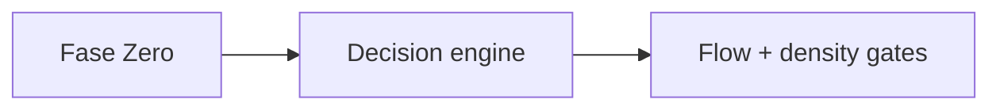

# Density templates: commit, PR, and issue bodies

Information density means every commit/PR/issue body carries the context
a reviewer (human or agent) needs without opening other tools. Write
the body to a file first, then hand it to git/gh - never inline
multi-line bodies in `-m`/`--body` flags.

## Wiring rules

- `Refs: #N` - relates this artifact to issue/PR N without closing it.
  Use in commits, follow-up comments, docs, partial work.
- `Closes #N` - this artifact completes issue N. Use only in the PR (or
  issue) that finishes the work; GitHub auto-closes on merge to the
  default branch.
- One `Closes` per artifact unless the PR genuinely completes several
  issues; prefer a parent issue + sub-issues when work splits.

## Commit message template (`git commit -F <file>`)

Subject line: `type(scope): short description (#N)` - conventional
commit, <= 72 chars, issue number in parentheses when one exists.

```text
type(scope): short description (#612)

Contexto e Motivacao
<why this change exists; the problem or request being addressed>

Detalhamento Tecnico
<what changed, where, and how; key files/mechanisms>

Decisoes Arquiteturais e Trade-offs
<choices made, alternatives rejected, constraints honored>

Validacao
<commands run and their results; tests added or updated>

Refs: #612
```

Rules:

- Atomic commits: one logical change per commit; split before `add -A`
  when the diff mixes concerns.
- Body sections are mandatory for anything beyond a trivial fix;
  drop a section only when it is genuinely empty, and say why.
- `Refs:` goes last; multiple refs allowed, one per line.
- No AI signatures, no trailers, no emojis unless the repo uses them.

## PR body template (`gh pr create --body-file <file>`)

````markdown
## Summary

<one paragraph: what and why>

<smallest diagram/diff-sketch/tree that makes the point; Mermaid when
flow matters>



## Evidence

- **Before:** <failing output / screenshot / repro>
- **After:** <passing output / screenshot / repro>

## Merge Danger

**Door:** <one-way or two-way>

**Blast Radius:** <one-word description>

## Architectural context and trade-offs

<decisions, rejected alternatives, ADR links via Refs:>

## Validation checklist

- [ ] Tests added/updated for the change
- [ ] `python -m pytest` (or project equivalent) green locally
- [ ] Lint/typecheck clean
- [ ] Commit messages follow the density template
- [ ] Docs/ADR updated when behavior or architecture changed

Closes #612
````

Rules:

- `Closes #N` sits at the end; it is the wiring that auto-closes.
- Small PRs still get the full skeleton; delete sections that do not
  apply rather than padding them.
- Link the plan/ADR/issue when they exist (`Refs: #N`, file paths).

## Issue body template (`gh issue create --body-file <file>`)

```markdown
## Problem

<what is broken, missing, or wanted; observable symptom>

## Scope

<what is in and explicitly out of scope>

## Acceptance criteria

- [ ] <verifiable outcome 1>
- [ ] <verifiable outcome 2>

## Context

<links to plans, ADRs, related issues; `Refs:` where useful>

## Labels / routing

<labels applied or suggested; flow hint if known>
```

Rules:

- Acceptance criteria must be checkable by running something, not by
  opinion.
- Sub-issue breakdown belongs to the parent issue: create children with
  `gh issue create --parent <N>` and link them in Context.

## Comment template (status updates)

```markdown
**Status:** <done / in progress / blocked>

<what changed since last update, evidence links, next step>

Refs: #612
```

## Release notes snippet (`--generate-notes` fallback)

When `gh release create --generate-notes` output is too thin, write
notes to a file and pass `--notes-file`:

```markdown
## What's Changed

* <user-facing change 1> by @user in #55
* <user-facing change 2> by @user in #56

**Full Changelog**: <compare-url>
```

Group by type (features, fixes, docs, ci) matching the repo's label
taxonomy; never paste raw commit subjects verbatim when they are
density-template bodies - summarize.
